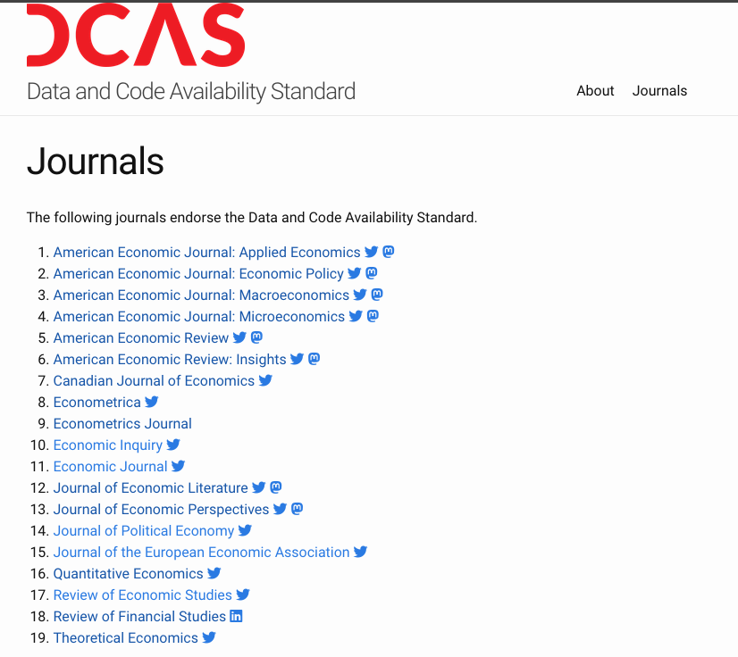
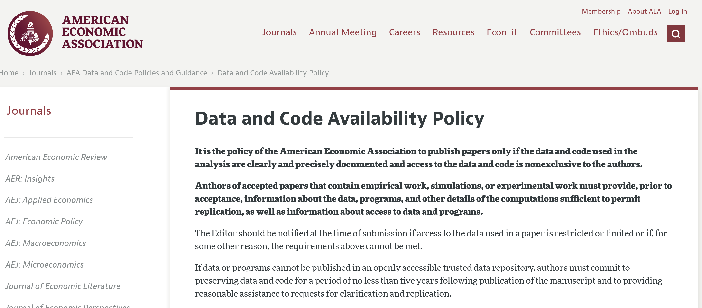
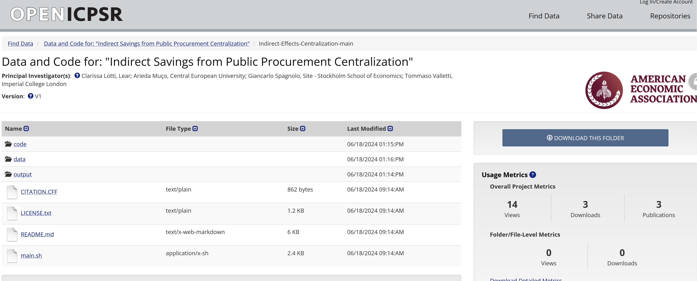

(what-is-a-replication-package)=
# What are the goals?

## Journals require replication packages

## What is a replication package?

- [AEA Data and Code Availability policy](https://www.aeaweb.org/journals/data/data-code-policy)
- [Data and Code Availability Standard](https://datacodestandard.org/)
- [AEA Data and Code Repository](https://www.openicpsr.org/openicpsr/search/aea/studies)

% TODO: the presentation shows these as three links with no definition of "replication package"; a definition sentence is still missing (see TODO.md)

## Example of deposit

